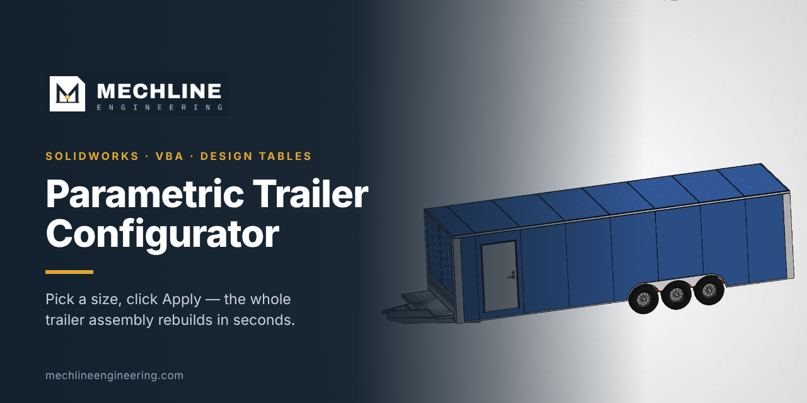
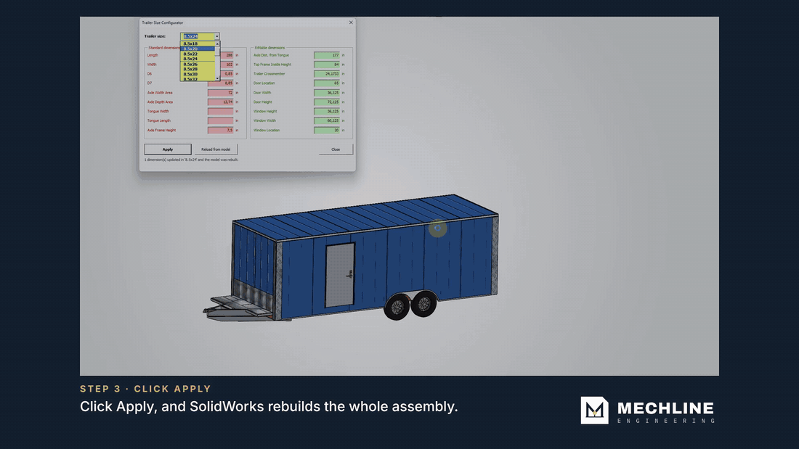

# Parametric Trailer Configurator for SolidWorks

A VBA macro that opens a configurator form inside SolidWorks. You pick a trailer size, adjust a few details and click **Apply**. The complete trailer assembly then rebuilds itself: walls, floor, frame, doors, windows and the number of axles.

## The problem

A custom trailer usually means rebuilding the model for every new size. That takes hours of manual edits, and every edit is a chance to get a dimension wrong.

## How it works

1. **Pick a size.** The macro opens the *Trailer Size Configurator* inside SolidWorks. Standard dimensions for that size (length, width, axle area, tongue and frame heights) load straight from the Excel design table and stay locked.
2. **Adjust the details.** The parameters that change from order to order stay editable: axle distance from the tongue, top frame inside height, cross-member spacing, and the size and position of doors and windows.
3. **Click Apply.** SolidWorks rebuilds the whole assembly. Walls, floor, frame and the axle count all update together.
4. **Make the drawings.** Every variant is a complete assembly, ready for drawings, cut lists and manufacturing. One click on **Export cut list** sends the steel cut list to Excel (see [solidworks-steel-cut-list](https://github.com/mechline-engineering/solidworks-steel-cut-list)).

**Range:** from a compact 7 × 12 ft single-axle trailer up to 8.5 × 38 ft with three axles. A new configuration takes seconds instead of hours.

## Built with

| | |
|---|---|
| CAD | SolidWorks (parts, assemblies, weldments) |
| Automation | SolidWorks API, VBA user form |
| Data | Excel design table (one row per standard size) |
| Units | Imperial (inches and feet) |

## Source code

This repository is a showcase. The macro and the master model were built for production use, so the source is not public.

**Need a configurator like this for your own product line** (trailers, enclosures, frames, lifts, conveyors)? We build them on top of your existing SolidWorks models.

## Contact

**Mechline Engineering** – mechanical design, FEA and contract manufacturing for manufacturers in the US, Europe and Australia.

- Website: https://www.mechlineengineering.com
- Quote request: https://www.mechlineengineering.com/#quote
- Email: info@mechlineengineering.com
- More automation projects: https://github.com/mechline-engineering
